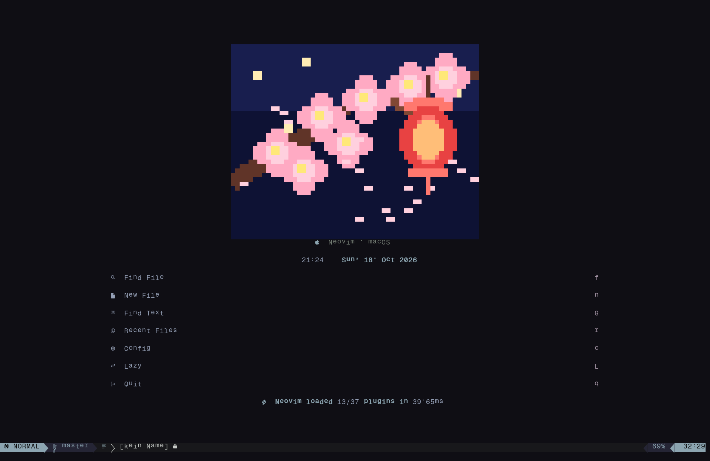

# Miracs Dotfiles

Neovim- und tmux-Konfiguration, verwaltet mit GNU Stow. Das Neovim-Dashboard
zeigt bei jedem Start ein wechselndes Pixel-Art-Motiv.



## Inhalt

| Ordner  | Was drin ist                                                        |
| ------- | ------------------------------------------------------------------- |
| `nvim`  | Neovim-Konfiguration mit lazy.nvim, Snacks, blink.cmp und Mason     |
| `tmux`  | tmux-Konfiguration mit Ukiyo-Statusleiste und Theme-Menü            |
| `tools` | Generator für die Dashboard-Motive (nur zum Bearbeiten nötig)       |
| `docs`  | Bilder für dieses README                                            |

## Schnellstart

Benötigt werden **Git**, **Neovim** und **GNU Stow**.

```sh
git clone https://github.com/Mirac61/nvim-config.git ~/dotfiles
cd ~/dotfiles
stow --target="$HOME" nvim
nvim
```

Beim ersten Start lädt Neovim die Plugins, dafür ist eine Internetverbindung
erforderlich. Die tmux-Konfiguration ist optional:

```sh
stow --target="$HOME" tmux
```

> **Schon eine Neovim-Konfiguration vorhanden?** GNU Stow meldet Konflikte,
> wenn am Ziel bereits Dateien liegen. Verschiebe die bestehende Konfiguration
> (`~/.config/nvim`) zuerst, bevor du sie verlinkst.

## Neovim

Die Leader-Taste ist `Space`. Plugins liegen in `lua/plugins/`, eigene Tasten in
`lua/config/keymaps.lua`. Die Versionen sind in `lazy-lock.json` festgehalten.

Ein paar Tasten für den Einstieg:

| Taste        | Aktion                       |
| ------------ | ---------------------------- |
| `<leader>e`  | Datei-Explorer               |
| `<leader>ff` | Dateien suchen               |
| `<leader>fw` | Im Projekt suchen (Grep)     |
| `<leader>fb` | Offene Buffer                |
| `<leader>fk` | Alle Tastenkürzel durchsuchen |
| `jk`         | Insert-Modus verlassen       |

Language Server (unter anderem `gopls`, `clangd`, `lua_ls`, `marksman`) werden
über Mason installiert. Zum Formatieren dient conform.nvim.

Farbschemata: Kanagawa, Tokyo Night, Nightfox, Gruvbox, Rosé Pine, Everforest,
Nord, Vercel und ein eigenes Schema namens Caelestia.

### lazygit (optional)

Die Konfiguration liegt unter `nvim/.config/nvim/lazygit/`. Stow legt sie
mit ab, lazygit liest sie dort aber nicht. Sie muss einmalig an den
lazygit-Pfad verlinkt werden. Befehle und Voraussetzung (`delta`) stehen im
README dieses Ordners.

## tmux

Die Statusleiste liegt oben und nutzt das Plugin Ukiyo. Sessions werden mit
tmux-resurrect und tmux-continuum wiederhergestellt.

Die Plugins kommen über TPM:

```sh
git clone https://github.com/tmux-plugins/tpm ~/.tmux/plugins/tpm
```

Danach in tmux `prefix + I` drücken. Mit `prefix + T` öffnet sich das
Theme-Menü (Vercel, Kanagawa, Tokyo Night, Nord, Gruvbox). Ohne TPM bleibt die
Konfiguration nutzbar, es fehlen nur Statusleiste und Plugins.

## Dashboard-Motive

Es gibt zwölf Motive im japanischen Nacht- und Schrein-Stil: Mond, Koi, Torii,
Pagode, Kirschblüten- und Gedenklaternen, Katzen, Higanbana, Bambuswald mit
Glühwürmchen, Kitsune-Maske und Samurai. Ein Motiv wird zufällig ausgewählt,
direkte Wiederholungen werden vermieden.

Die Grafik erscheint **nur in Neovim**. Fastfetch bleibt davon unabhängig. Für
die Pixel-Farben wird ein Terminal mit True-Color-Unterstützung empfohlen.

### Motive bearbeiten (optional)

Zum Verwenden der Konfiguration sind weder Python noch Pillow nötig. Nur wenn du
die Pixelbilder ändern oder neu erzeugen möchtest, installiere Pillow und führe
den Generator aus:

```sh
python3 -m pip install Pillow
python3 tools/dashboard_art_gen.py
```

Der Generator aktualisiert `nvim/.config/nvim/lua/config/dashboard_art.lua`.
Vorschau-PNGs lassen sich zusätzlich mit `--preview-dir PFAD` erzeugen.
